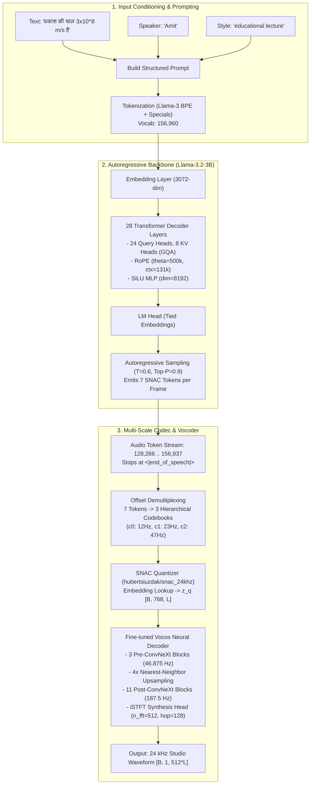
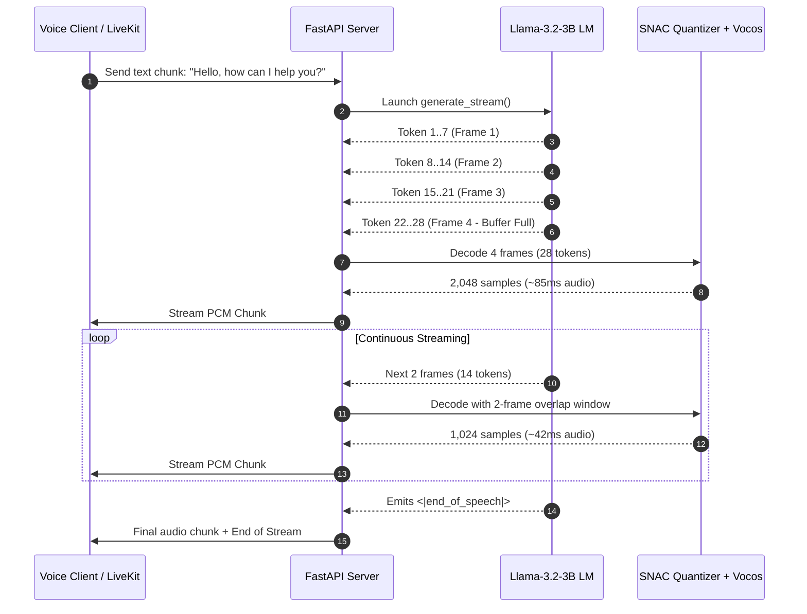

# Document B: Technical Deep Dive & Learning Guide — Indic-Speak

> **Model:** [`bodhan-ai/indic-speak`](https://huggingface.co/bodhan-ai/indic-speak)  
> **Authors:** Bodhan AI (IIT Madras) & AI4Bharat  
> **Document Purpose:** Complete architectural breakdown, token contract specifications, vocoder mechanics, mathematical principles, and engineering trade-offs.

---

## 1. Overview & Problem Formulation

### 1.1 The Challenge of Indian Language Speech Synthesis
Conventional Text-to-Speech (TTS) models frequently collapse when applied to Indian linguistic contexts due to three major hurdles:
1. **Pervasive Code-Switching & Code-Mixing (Hinglish/Tanglish/Kanglish)**: Indian speakers routinely embed English words, technical phrases, and acronyms within vernacular sentences. Standard multilingual models either switch accents abruptly (sounding like two different speakers spliced together) or mangle English pronunciation with inappropriate regional phonetic rules.
2. **Complex STEM & Educational Notation**: Reading mathematical equations ($E = mc^2$, $\frac{d^2y}{dx^2}$, $\sqrt{x^2+1}$), chemical formulas ($H_2SO_4$, $KMnO_4$), scientific units ($\text{m/s}^2$, $\text{kg}\cdot\text{m}^{-3}$), and fractions accurately requires semantic comprehension of context before phonetic realization. Traditional grapheme-to-phoneme (G2P) rule-based engines fail on these without brittle hand-coded regexes.
3. **Phonetic Cadence & Comprehension**: Fast, synthetic announcement-style speech fails in pedagogical and long-form settings. Indian learners require explanatory pacing with natural pause placement reflecting syntactic phrasing rather than mechanical comma stops.

### 1.2 The Indic-Speak Solution
Indic-Speak re-frames multilingual TTS as an **autoregressive language modeling task**:
* A pretrained autoregressive Large Language Model (`Llama-3.2-3B`) reads input text containing arbitrary script, mathematical formulas, or code-switched text.
* The model autoregressively generates **discrete acoustic codes** representing quantized audio frames.
* A specialized **neural vocoder** translates these discrete acoustic codes into high-fidelity 24 kHz continuous audio waveforms.

---

## 2. End-to-End Architectural Decomposition

Indic-Speak combines two core neural systems:
1. **The Autoregressive Speech Language Model (Speech LM)**: Predicts discrete multi-scale audio tokens conditioned on text and speaker prompts.
2. **The Acoustic Quantizer & Neural Vocoder**: Reconstructs continuous waveforms from generated discrete tokens.



---

## 3. Deep Dive: Component Architectures

### 3.1 The Backbone Speech Language Model (`Llama-3.2-3B`)
The language model backbone is directly derived from Meta's `Llama-3.2-3B`, fine-tuned end-to-end to output interleaved speech codes.

* **Layer Count ($N_{\text{layers}}$)**: 28 transformer decoder layers.
* **Hidden Dimension ($d_{\text{model}}$)**: 3,072.
* **Feed-Forward Dimension ($d_{\text{ffn}}$)**: 8,192 with SwiGLU activation.
* **Attention Mechanism**:
  * **Grouped-Query Attention (GQA)**: 24 query attention heads and 8 key/value heads (3:1 query-to-KV ratio). This reduces KV-cache memory during autoregressive generation by 66% compared to standard multi-head attention.
  * **Head Dimension**: 128.
  * **Rotary Position Embeddings (RoPE)**: Configured with `rope_theta = 500,000.0`, high frequency factor 4.0, low frequency factor 1.0, factor 32.0, providing native context up to 131,072 tokens.
* **Embedding & Head Tying**: `tie_word_embeddings = true`. The input embedding weight matrix `model.embed_tokens.weight` (`[156960, 3072]`) is shared with the output projection layer `lm_head.weight`.
* **Parameter Breakdown**:
  * Stored weights in Safetensors: **3,300,928,512 parameters** (3.30B parameters).
  * Expanded Computational Graph (counting tied output projection): **3,783,109,632 parameters** (3.78B parameters).
  * Weight storage footprint: **6.60 GB** in `bfloat16`.

---

### 3.2 The Token Contract & Discontinuous Vocabulary Map

One of the most critical engineering details of Indic-Speak is its **Token Contract** (vocabulary size: `156,960`). Understanding this layout is essential for decoding and streaming:

```
[0 ────────── 127,999]  Llama-3 BPE Text Tokens (128,000 tokens)
[128,000 ──── 128,255]  Llama-3 Native Special Tokens (256 tokens)
[128,256 ──── 128,265]  Project Control Tokens (10 tokens: speech markers, human/AI turns)
[128,266 ──── 156,937]  SNAC Audio Band (28,672 tokens: 7 codebooks × 4,096 tokens)
[156,938 ──── 156,959]  Conditioning Wrappers & Non-Verbals (22 tokens)
```

#### Detailed Breakdown of Token Ranges:

| Token ID Range | Token Category | Functional Role |
| :--- | :--- | :--- |
| `0 – 127,999` | **Llama-3 Text BPE** | Native multilingual text representation for scripts, English, numbers, and symbols. |
| `128,000` | `<\|begin_of_text\|>` | Marks the start of sequence. |
| `128,001` | `<\|end_of_text\|>` | Native end of sequence. |
| `128,009` | `<\|eot_id\|>` | End of turn marker. |
| `128,257` | `<\|start_of_speech\|>` | **Speech Initiation Token**: Emitted by the model itself as its very first generated token before speech frames begin. |
| `128,258` | `<\|end_of_speech\|>` | **Speech Termination Token**: Signals the end of audio emission. Serves as primary stop token. |
| `128,259 – 128,262` | `<\|start_of_human\|>`, `<\|end_of_human\|>`, `<\|start_of_ai\|>`, `<\|end_of_ai\|>` | Turn framing markers. |
| `128,263` | `<\|pad\|>` | Padding token. |
| `128,266 – 156,937` | **SNAC Audio Band** | Continuous band of 28,672 audio tokens encoding 7 codebook slots. |
| `156,938 / 156,939` | `<\|speaker>` / `<speaker\|>` | Speaker conditioning tag delimiters. |
| `156,940 / 156,941` | `<\|style>` / `<style\|>` | Style and emotion conditioning tag delimiters. |
| `156,942 / 156,943` | `<\|env>` / `<env\|>` | Acoustic environment tag delimiters (e.g., classroom, studio, outdoor). |
| `156,944 – 156,959` | Non-verbal tokens | Dedicated tokens: `<\|nv_breath\|>`, `<\|nv_laugh\|>`, `<\|nv_sigh\|>`, `<\|nv_cough\|>`, etc. |

---

### 3.3 The SNAC Multi-Scale Hierarchical Interleaving Scheme

Standard audio language models (e.g., AudioPaLM, MusicLM, Bark) generate audio codes either via flattened sequences or delayed patterns. Indic-Speak utilizes **SNAC 24 kHz** (Multi-Scale Neural Audio Codec), which organizes speech into three hierarchical temporal scales:

* **Level 0 ($c_0$)**: 12 Hz (Coarsest temporal scale, global phonetic/prosodic structure)
* **Level 1 ($c_1$)**: 23 Hz (Intermediate temporal scale, 2x oversampled relative to $c_0$)
* **Level 2 ($c_2$)**: 47 Hz (Finest acoustic scale, 4x oversampled relative to $c_0$, capturing fine pitch and harmonics)

#### The 7-Token Frame Interleaving:
Rather than generating parallel codebooks using multiple LM heads, Indic-Speak flattens each audio frame $i$ into a sequence of **7 consecutive tokens**:

$$\text{Frame } i = [\, c_0[i],\; c_1[2i],\; c_2[4i],\; c_2[4i+1],\; c_1[2i+1],\; c_2[4i+2],\; c_2[4i+3] \,]$$

#### Positional Offset Encoding:
To allow the single causal LM head to distinguish between codebook slots, each raw code $v \in [0, 4095]$ is offset by its **position within the 7-token frame** ($p \in [0, 6]$):

$$\text{Token ID} = \text{base} + (p \times 4096) + v \quad \text{where } \text{base} = 128,266$$

```
Frame Pos 0: base + 0*4096 = 128,266 .. 132,361  (Source: c0[i])
Frame Pos 1: base + 1*4096 = 132,362 .. 136,457  (Source: c1[2i])
Frame Pos 2: base + 2*4096 = 136,458 .. 140,553  (Source: c2[4i])
Frame Pos 3: base + 3*4096 = 140,554 .. 144,649  (Source: c2[4i+1])
Frame Pos 4: base + 4*4096 = 144,650 .. 148,745  (Source: c1[2i+1])
Frame Pos 5: base + 5*4096 = 148,746 .. 152,841  (Source: c2[4i+2])
Frame Pos 6: base + 6*4096 = 152,842 .. 156,937  (Source: c2[4i+3])
```

**Why this design is brilliant**: The offset encodes *positional syntax directly into the token ID*. The LM learns strict grammatical transitions: a token in range `[128266..132361]` must always be followed by a token in range `[132362..136457]`, guaranteeing structurally valid frames without external state machines.

---

### 3.4 Acoustic Math: Token-to-Audio Temporal Relationship

* **Audio Sample Rate**: $f_s = 24,000 \text{ Hz}$.
* **Samples per Frame**: Each $c_0$ frame represents exactly **512 audio samples**.
* **Frame Duration**:
  $$\Delta t_{\text{frame}} = \frac{512 \text{ samples}}{24,000 \text{ samples/sec}} = 21.333 \text{ milliseconds}$$
* **Raw Acoustic Bandwidth**:
  $$\text{Raw Token Rate} = \frac{7 \text{ tokens}}{21.333 \text{ ms}} = 328.125 \text{ tokens/second}$$
* **Deduplication Compression**: During training data compilation, consecutive identical frames (frames sharing the same $c_0$) during silences or steady-state vowels were compressed/deduplicated. Hence, the effective generation speed in continuous speech averages:
  $$\text{Empirical Token Rate} \approx 82 \text{ to } 120 \text{ tokens/second}$$
  **Rule of thumb**: $\sim 82\text{ tokens} \approx 1\text{ second of audio}$.

---

### 3.5 The Neural Vocoder: Fine-Tuned Vocos vs. Stock SNAC

SNAC ships with a stock time-domain transposed convolutional decoder. Indic-Speak replaces this decoder with a fine-tuned **Vocos** decoder (`vocos_dec_v9_gen`, checkpoint step 200,000, 467 MB).

#### Vocos Architecture Specification:
1. **Latent Input**: SNAC quantizer produces continuous quantized latent $z_q \in \mathbb{R}^{B \times 768 \times L}$ at $46.875 \text{ Hz}$ ($L$ is the number of frames).
2. **Stem Layer**: 1D Convolution mapping 768 to 512 dimensions (`kernel_size=7, padding=3`).
3. **Pre-Upsample Backbone**: 3 ConvNeXt-1D blocks operating at $46.875 \text{ Hz}$.
4. **Temporal Upsampler**: 4x nearest-neighbor repetition + 1D Convolution (`kernel_size=7`), elevating feature rate from $46.875 \text{ Hz}$ to $187.5 \text{ Hz}$.
5. **Post-Upsample Backbone**: 11 ConvNeXt-1D blocks operating at $187.5 \text{ Hz}$ with LayerScale initialization ($ls = 1 / 14$).
6. **Synthesis Head**: Inverse Short-Time Fourier Transform (**iSTFT**) Head:
   * Linear projection to $N_{\text{fft}} + 2 = 514$ channels ($257$ log-magnitudes + $257$ phases).
   * Parameterized with $N_{\text{fft}} = 512$, $\text{hop\_length} = 128$, Hann window.
   * Direct iSTFT synthesis: Converts complex spectrogram $\text{spec} = \text{mag} \cdot (\cos\phi + j\sin\phi)$ directly into time-domain audio in a single matrix operation.
   * Frame alignment invariant: $\text{hop} \times (\text{upsample} \times L) = 128 \times 4 \times L = 512 \times L$ audio samples. Exactly preserves SNAC's 512 samples per latent frame without fractional sample drift.

#### Why Vocos Replaces Stock SNAC:
| Dimension | Stock SNAC Decoder | Fine-Tuned Vocos Decoder |
| :--- | :--- | :--- |
| **Architecture** | Cascaded Transposed Convolutions + Snake Activations | ConvNeXt-1D + iSTFT Head |
| **Synthesis Method** | Time-domain sequential upsampling | Frequency-domain complex spectrogram $\to$ iSTFT |
| **High-Frequency Quality** | Prone to tonal buzzing / metallic artifacts | Crystal-clear sibilants ($s, sh$), crisp fricatives |
| **Computational Speed** | ~8 ms per second of audio on GPU | **~2.1 ms per second of audio** on GPU (4x faster) |
| **Memory Footprint** | ~79 MB | ~52M params (~104 MB in fp16 weights) |

---

## 4. Prompt Engineering & Conditioning Syntax

The model requires a strict sequence format. Violating token boundaries results in degradation or silence.

### 4.1 Full Prompt Structure
```
<|start_of_human|><|begin_of_text|><|speaker>SPEAKER_NAME<speaker|>\n<|style>STYLE_TAG<style|>\nINPUT_TEXT<|eot_id|><|end_of_human|><|start_of_ai|><|start_of_speech|>
```

* **Speaker block**: Optional. If omitted, uses an averaged dataset voice.
* **Style block**: Optional. If omitted, defaults to neutral explanatory delivery.
* **Separators**: A single newline `\n` follows each metadata tag.
* **Turn Closing**: `<|eot_id|><|end_of_human|><|start_of_ai|>` primes the model to reply.
* **Speech Opener**: The prompt ends with `<|start_of_speech|>`. The model generates audio tokens immediately thereafter until emitting `<|end_of_speech|>`.

### 4.2 Multi-Turn Conversational Layout
For dialogue or agent back-and-forth, the model supports an inline multi-turn format:
```
<|start_of_human|><|begin_of_text|><|speaker>Amit<speaker|>\nFirst turn text\n\n<|speaker>Kavya<speaker|>\nSecond turn text<|eot_id|><|end_of_human|><|start_of_ai|><|start_of_speech|>
```
* Note the mandatory double newline `\n\n` separating speaker turns.

---

## 5. Streaming vs. Non-Streaming: Latency Dynamics

### 5.1 The Default Non-Streaming Pipeline
In the repository's reference `inference.py`, the entire utterance is generated before any audio is produced:
```
[User Text] ──► Full LM Generate (e.g. 500 tokens, 1200ms) ──► Convert all Codes ──► Vocos Decode (35ms) ──► Return Audio
```
* **TTFA (Time-To-First-Audio)** = Full LM generation time ($\approx 1.2\text{ seconds}$).
* **Verdict for Real-Time Conversational AI**: **UNACCEPTABLE** for telephony/voice agents where conversational turns require TTFA $< 400\text{ ms}$.

### 5.2 Windowed Streaming Pipeline (The Production Architecture)
Because the Speech LM is autoregressive, audio tokens can be processed **incrementally**!



#### The Sliding Receptive Field Problem:
Why can't we decode 1 frame (7 tokens) in isolation?
* ConvNeXt-1D layers have kernel sizes of 7. Across 14 blocks, the receptive field spans approximately 3–4 frames.
* The iSTFT synthesis head uses a 512-sample Hann window with a 128-sample hop length. Synthesizing a single frame in isolation causes window boundary truncation, resulting in audible clicks/pops.
* **The Solution**: Maintain a **4-frame sliding context** (28 tokens). Decode the window, emit the central non-boundary audio samples, and advance the window.
* **Resulting TTFA**: Time to generate 28 tokens ($\sim 200 - 250\text{ ms}$) + Vocos decode ($\sim 3\text{ ms}$) = **$\approx 230 - 280\text{ ms}$ TTFA**!

---

## 6. Voice Library & Cross-Lingual Conditioning

### 6.1 Studio Voices by Language
Indic-Speak includes **44 studio voices** covering 22 official languages plus English:

| Language | Code | Tier | Female Voice | Male Voice | Pitch (F0) & Rate |
| :--- | :---: | :---: | :--- | :--- | :--- |
| **Hindi** | `hi` | Production | `Kavya` | `Amit` | Kavya: ~215 Hz (12.9 c/s) \| Amit: ~152 Hz (12.6 c/s) |
| **English** | `en` | Production | `Kavya` / `Ishita` | `Amit` / `Sourav` | 44 registered speakers with natural Indian English accents |
| **Bengali** | `bn` | Production | `Ishita` | `Sourav` | Ishita: ~266 Hz (11.6 c/s) \| Sourav: ~142 Hz (13.2 c/s) |
| **Tamil** | `ta` | Production | `Anitha` | `Arun` | Anitha: ~210 Hz (13.2 c/s) \| Arun: ~121 Hz (14.5 c/s) |
| **Telugu** | `te` | Production | `Sravani` | `Vamsi` | Sravani: ~260 Hz (12.3 c/s) \| Vamsi: ~143 Hz (11.8 c/s) |
| **Kannada** | `kn` | Production | `Deepika` | `Adarsh` | Deepika: ~209 Hz (10.9 c/s) \| Adarsh: ~144 Hz (12.0 c/s) |
| **Malayalam** | `ml` | Production | `Lakshmi` | `Kiran` | Lakshmi: ~237 Hz (13.2 c/s) \| Kiran: ~131 Hz (14.0 c/s) |
| **Marathi** | `mr` | Production | `Anagha` | `Chinmay` | Anagha: ~261 Hz (11.7 c/s) \| Chinmay: ~173 Hz (12.6 c/s) |
| **Gujarati** | `gu` | Production | `Dhara` | `Parth` | Dhara: ~273 Hz (10.7 c/s) \| Parth: ~164 Hz (12.7 c/s) |
| **Punjabi** | `pa` | Production | `Kaur` | `Manpreet` | Kaur: ~254 Hz (11.9 c/s) \| Manpreet: ~184 Hz (13.3 c/s) |
| **Odia** | `or` | Production | `Itishree` | `Akash` | Itishree: ~263 Hz (11.5 c/s) \| Akash: ~151 Hz (11.8 c/s) |
| **Assamese** | `as` | Production | `Prastuti` | `Ankur` | Prastuti: ~216 Hz (12.5 c/s) \| Ankur: ~108 Hz (11.9 c/s) |
| **Urdu** | `ur` | Production | `Saba` | `Zaid` | Saba: ~209 Hz (11.8 c/s) \| Zaid: ~127 Hz (12.8 c/s) |

### 6.2 Cross-Lingual Portability
Every voice can synthesize speech in every supported language:
* E.g., `Amit` (native Hindi) can synthesize Tamil, Marathi, or English.
* When synthesizing English, `Amit` speaks with a natural, clear Indian accent consistent with his Hindi persona.

---

## 7. Comparative Analysis: Indic-Speak vs. Alternative Models

| Feature / Metric | Indic-Speak (Bodhan AI) | Svara-TTS (Sarvam AI) | Indic-Parler-TTS (AI4Bharat) | Piper TTS (Local ONNX) | ElevenLabs (Cloud SaaS) |
| :--- | :--- | :--- | :--- | :--- | :--- |
| **Model Type** | Discrete Audio LLM (3.3B) + Vocos | Acoustic Model + Vocoder | Parler-TTS (880M) | VITS / End-to-end | Proprietary Latent Diffusion |
| **Code-Mixing Quality** | **Superior (Class-leading)** | Very Good | Moderate (breaks on idioms) | Poor (unsupported) | Good |
| **STEM / Math Reading** | **Exceptional (Trained)** | Poor (spells characters) | Poor | Fails completely | Moderate |
| **Language Count** | **23 Languages** | 10–12 Languages | 22 Languages | 3–5 Indian Languages | High (~30+) |
| **Latency (TTFA)** | ~220 ms (streaming) | ~350 ms | ~400 ms | **< 80 ms** | ~250–350 ms |
| **Self-Hosting Cost** | Requires GPU (10 GB VRAM) | Requires GPU (16 GB) | Requires GPU (12 GB) | **Runs on cheap CPU** | API per-char pricing ($$$) |
| **License** | Indic Open Model License | Proprietary / Commercial | MIT / Open Source | MIT | Proprietary SaaS |
| **Commercial Freedom** | Free for self-hosted apps; API hosting requires approval | Paid commercial terms | Fully permissive | Fully permissive | Paid API |

---

## 8. Glossary of Technical Terminology

* **SNAC (Scalable Neural Audio Codec)**: A multi-scale residual vector-quantized audio autoencoder that compresses 24 kHz audio into hierarchical discrete tokens at differing temporal strides.
* **Vocos**: A fast neural vocoder architecture based on ConvNeXt-1D blocks and an Inverse Short-Time Fourier Transform (iSTFT) synthesis head that reconstructs audio from spectral features without recurrent layers.
* **GQA (Grouped-Query Attention)**: An attention variant where multiple query heads share a single key/value head, reducing memory bandwidth demands during inference.
* **iSTFT Head**: A network layer that predicts magnitude and phase spectrograms, converting them into time-domain audio via inverse Fourier transform rather than transposed convolutions.
* **EMA (Exponential Moving Average)**: A technique where model weights during inference represent a moving average of training weights across optimization steps, ensuring stable acoustic generation.
* **Real-Time Factor (RTF)**: The ratio of audio generation time to generated audio duration: $\text{RTF} = \frac{T_{\text{generation}}}{T_{\text{audio}}}$. Values $< 1.0$ indicate faster-than-real-time performance.
